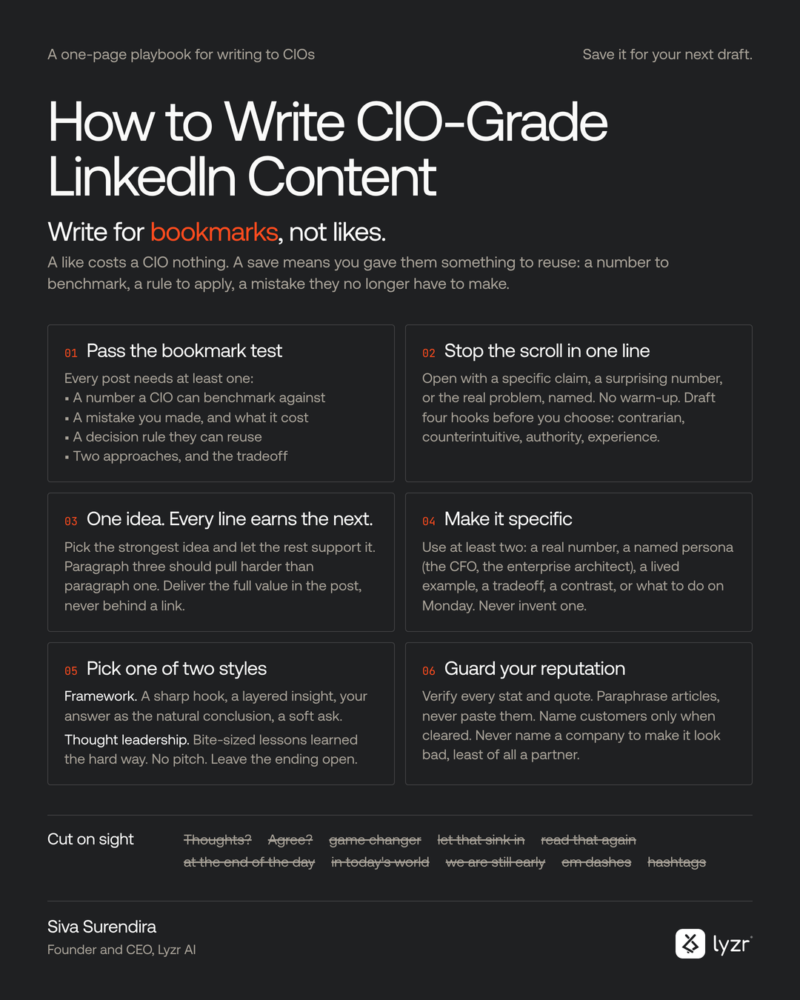

# LinkedIn Bookmark Writer

A Claude skill that writes LinkedIn posts people save, not just like.



A like costs the reader nothing. A save means you gave them something to reuse: a number to benchmark against, a decision rule, a mistake they no longer have to make. This skill turns raw notes, call transcripts, articles and half-formed ideas into posts built for the save, and it tells you plainly when a draft is not there yet.

## What it does

- **Runs the bookmark test.** Every post needs at least one of: a specific number, a mistake and what it cost, a reusable decision rule, or two approaches with the tradeoff. If your material has none, it says so and asks the one question that fixes it.
- **Writes in two styles.** Framework (sharp hook, layered insight, your answer as the natural conclusion, soft ask) or Thought leadership (bite-sized lessons learned the hard way, no pitch, an ending left open).
- **Gives four hooks with every post.** One each: contrarian, counterintuitive, authority, experience.
- **Never invents.** No made-up numbers, quotes or experiences. Missing specifics become visible placeholders for you to fill.
- **Guards your reputation.** Verifies claims, paraphrases rather than pastes, keeps competitors and partners out of negative contexts, and flags customer names that may not be cleared.
- **Enforces the bans.** No em dashes, no "Thoughts?" endings, no "game changer", no hashtags or emojis by default, no markdown that LinkedIn cannot render.
- **Ships with a linter** that checks a draft against those bans before you post.

## Install

### Claude (web, desktop and mobile)

1. Download [`dist/linkedin-bookmark-writer.zip`](dist/linkedin-bookmark-writer.zip).
2. In Claude, go to **Customize > Skills**, click **+**, then **Create skill**, then **Upload a skill**.
3. Upload the ZIP. The skill appears in your list, where you can turn it on or off.

Skills need code execution turned on (Settings > Capabilities on Free, Pro and Max; your admin controls it on Team and Enterprise).

### Claude Code

```bash
git clone https://github.com/sivasurend/worlds-greatest-linkedin-post-writer-skill.git
cp -r worlds-greatest-linkedin-post-writer-skill/skills/linkedin-bookmark-writer ~/.claude/skills/
```

To share it with your team instead, copy the folder into `.claude/skills/` inside your project and commit it.

### Any other AI assistant

Paste the contents of [`SKILL.md`](skills/linkedin-bookmark-writer/SKILL.md) into the system prompt or custom instructions. Paste [`references/examples.md`](skills/linkedin-bookmark-writer/references/examples.md) after it if you want the worked examples too.

## Use it

Ask the way you normally would:

- "Turn these notes into a LinkedIn post: ..."
- "Rewrite this draft so people save it."
- "Give me hooks for this idea."
- "Critique this post before I publish it."

## Make it sound like you

Fill in [`references/voice-profile.md`](skills/linkedin-bookmark-writer/references/voice-profile.md) once: who your readers are, the numbers and stories you are comfortable sharing, the names to handle with care, your product names, and any words you never want to see. Keep it where your assistant can read it. The skill works without it and offers to set one up after your first post.

## Check a draft

```bash
python skills/linkedin-bookmark-writer/scripts/lint_post.py post.txt
```

It flags dashes, banned phrases, markdown, hashtags, emojis and bait endings, and warns when the opening line is long enough to be cut off before "see more".

## What is inside

```
skills/linkedin-bookmark-writer/
  SKILL.md                    the instructions the assistant follows
  references/voice-profile.md template for your own voice and rules
  references/examples.md      one worked example in each style
  scripts/lint_post.py        checks a draft against the bans
dist/linkedin-bookmark-writer.zip   ready to upload to Claude
assets/poster.png                   the one-page version
```

## License

MIT. Made by Siva Surendira at [Lyzr AI](https://www.lyzr.ai).
